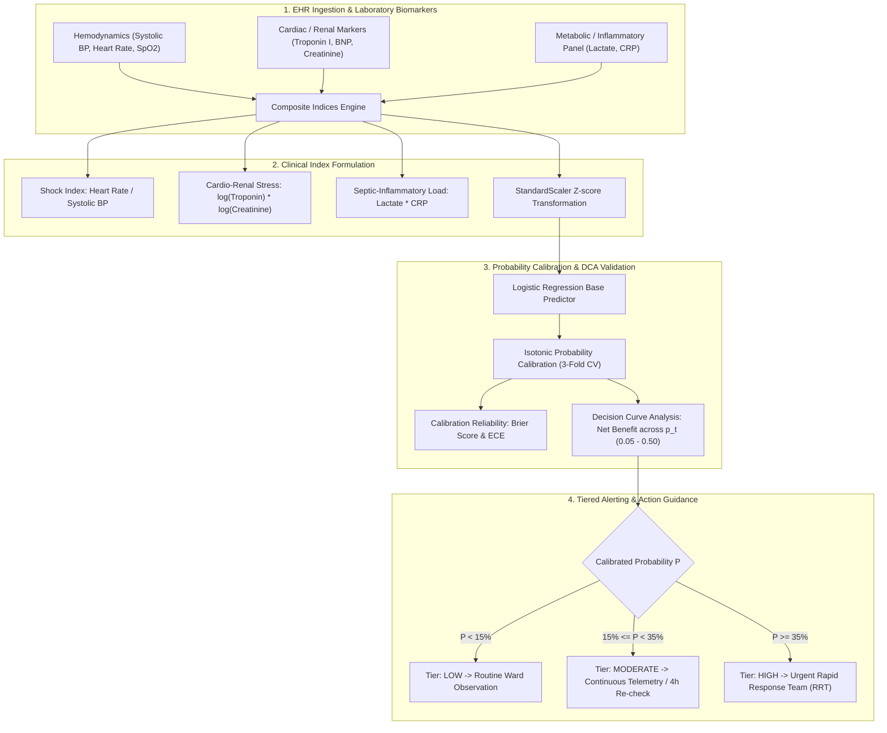

<div align="center">

# 🩺 Clinical Biomarker Risk Engine
### Calibrated Probability Stratification, Brier Reliability Scoring & Decision Curve Analysis (DCA)

[](https://github.com/yakupakcy36/clinical-biomarker-risk-engine/actions/workflows/ci.yml)
[](https://www.python.org/downloads/release/python-3120/)
[](https://opensource.org/licenses/MIT)
[](https://fastapi.tiangolo.com)
[](https://www.docker.com/)

</div>

---

## 📌 Executive Summary

Deploying predictive machine learning in clinical medicine requires far more than raw discrimination (ROC-AUC). When a model predicts a 20% risk of 30-day deterioration, exactly 20 out of 100 such patients must experience the event. Standard uncalibrated neural networks and tree ensembles are systematically overconfident, risking harmful interventions on false alarms or undertreating high-risk patients.

Furthermore, statistical significance does not imply clinical utility. **Decision Curve Analysis (DCA)** (Vickers & Elkin, *BMJ*) is the international medical informatics gold standard for demonstrating that acting on model alerts yields a higher **Net Clinical Benefit** than empirical default policies ("treat all" or "treat none") without requiring arbitrary cost-benefit dollar conversions.

**`clinical-biomarker-risk-engine`** evaluates longitudinal blood biomarkers (Troponin I, BNP, Serum Creatinine, C-Reactive Protein, Lactate) and hemodynamic vital signs. It enforces **Isotonic Probability Calibration**, computes **Expected Calibration Error (ECE)** and **Brier reliability**, and yields actionable clinical alerts with local biomarker explanations.

---

## 🏗️ Architecture & Medical Decision Flow



---

## 🔬 Mathematical Formulations

### 1. Probability Calibration & Brier Score
Given true binary outcomes $y_i \in \{0, 1\}$ and predicted risk probabilities $\hat{p}_i \in [0, 1]$:
$$\text{Brier Score} = \frac{1}{N} \sum_{i=1}^{N} \left(\hat{p}_i - y_i\right)^2 \quad (\text{Optimal} = 0.0)$$

### 2. Expected Calibration Error (ECE)
Predictions are partitioned into $M=10$ mutually exclusive probability bins $B_1, \dots, B_M$:
$$\text{ECE} = \sum_{m=1}^{M} \frac{|B_m|}{N} \left| \text{Accuracy}(B_m) - \text{Confidence}(B_m) \right|$$
$$\text{Accuracy}(B_m) = \frac{1}{|B_m|} \sum_{i \in B_m} y_i, \quad \text{Confidence}(B_m) = \frac{1}{|B_m|} \sum_{i \in B_m} \hat{p}_i$$

### 3. Decision Curve Analysis (DCA) Net Benefit
For a clinical threshold probability $p_t$, clinicians weigh false positives against true positives with exchange rate $w = \frac{p_t}{1 - p_t}$:
$$\text{Net Benefit}_{\text{Model}}(p_t) = \frac{\text{TP}}{N} - \frac{\text{FP}}{N}\left(\frac{p_t}{1 - p_t}\right)$$
$$\text{Net Benefit}_{\text{Treat All}}(p_t) = \text{Prevalence} - (1 - \text{Prevalence})\left(\frac{p_t}{1 - p_t}\right)$$

A model is clinically beneficial if $\text{Net Benefit}_{\text{Model}} > \max\left(\text{Net Benefit}_{\text{Treat All}}, 0\right)$.

---

## 🚀 Quick Start

### 1. Local Setup
```bash
git clone https://github.com/yakupakcy36/clinical-biomarker-risk-engine.git
cd clinical-biomarker-risk-engine

python -m venv .venv
source .venv/bin/activate  # On Windows: .venv\Scripts\activate
pip install -r requirements.txt
```

### 2. Run Pipeline & Benchmark Calibration
```bash
python -m src.pipeline --patients 2500
```

Sample output:
```text
====================================================================
CLINICAL BIOMARKER RISK ENGINE: PROBABILITY CALIBRATION & DCA
====================================================================
[1/4] Simulating longitudinal cohort of 2500 hospital admissions...
      Cohort 30-day deterioration event rate: 11.7%

[2/4] Fitting Isotonic Calibrated Classifier with 3-Fold Cross-Validation...

[3/4] Calibration & Discrimination Benchmark on Held-Out Test Set:
      ROC-AUC (Discrimination)        : 0.7159
      PR-AUC (Precision-Recall)       : 0.2771
      Brier Score (Reliability)       : 0.0852 (Lower is better)
      Expected Calibration Error (ECE): 0.0284

[4/4] Decision Curve Analysis (DCA) Net Benefit Comparison:
      Threshold (pt) | Net Benefit (Model) | Net Benefit (Treat All) | Recommendation
      --------------------------------------------------------------------
          0.05       |       0.0565        |         0.0547         | Use Model
          0.10       |       0.0358        |         0.0022         | Use Model
          0.15       |       0.0151        |         -0.0565         | Use Model
          0.20       |       0.0130        |         -0.1225         | Use Model
          0.25       |       0.0060        |         -0.1973         | Use Model
          0.30       |       -0.0003        |         -0.2829         | Treat None / Clinical Review

[Artifact] Saving calibrated model bundle to: artifacts/clinical_risk_engine_bundle.joblib
[SUCCESS] Clinical Risk Engine pipeline finished successfully.
```

### 3. Run Test Suite
```bash
pytest tests
```

---

## 🌐 Production REST API

Start the FastAPI microservice:
```bash
uvicorn api.app:app --host 0.0.0.0 --port 8000
```
Interactive documentation: `http://localhost:8000/docs`

### Sample Request (`POST /risk/assess`):
```bash
curl -X POST "http://localhost:8000/risk/assess" \
     -H "Content-Type: application/json" \
     -d '{
       "age": 74,
       "has_diabetes": 1,
       "has_hypertension": 1,
       "systolic_bp": 85.0,
       "heart_rate": 118.0,
       "spo2": 89.0,
       "troponin_i": 0.45,
       "bnp": 850.0,
       "creatinine": 2.4,
       "crp": 65.0,
       "lactate": 3.8
     }'
```

### Sample Response:
```json
{
  "predicted_risk_pct": 48.2,
  "risk_tier": "HIGH",
  "recommended_clinical_action": "Urgent Rapid Response Team (RRT) alert; consider immediate ICU transfer and arterial line placement.",
  "primary_risk_drivers": [
    "Elevated Serum Lactate (3.80 mmol/L) indicating cellular hypoperfusion",
    "Myocardial injury elevation: Troponin I (0.450 ng/mL)",
    "Severe refractory hypoxia: SpO2 (89.0%)",
    "Hypotensive / Circulatory shock index (1.39)",
    "Acute kidney injury: Creatinine (2.40 mg/dL)"
  ],
  "brier_reliability_score": 0.0852
}
```

---

## 🐳 Docker Deployment

Run with Docker Compose:
```bash
docker-compose up --build -d
```

Verify service status:
```bash
curl http://localhost:8000/health
```

---

## 📊 Repository Layout

```text
├── api/
│   ├── app.py              # FastAPI server & lifespan handlers
│   ├── schemas.py          # Pydantic v2 schemas
│   └── __init__.py
├── src/
│   ├── config.py           # Clinical thresholds & DCA evaluation points
│   ├── features.py         # Shock index & composite lab markers
│   ├── generator.py        # Synthetic EHR cohort generator
│   ├── model.py            # Calibrated probability model, Brier & DCA
│   ├── pipeline.py         # Out-of-sample benchmark CLI runner
│   └── __init__.py
├── tests/
│   ├── test_api.py         # Endpoint & schema validation tests
│   ├── test_features.py    # Shock index & log biomarker tests
│   ├── test_generator.py   # Cohort bounds & prevalence tests
│   └── test_model.py       # ECE & DCA calculation tests
├── Dockerfile
├── docker-compose.yml
├── requirements.txt
├── pytest.ini
└── README.md
```

---

## 📄 License
This project is open-source under the [MIT License](LICENSE).
